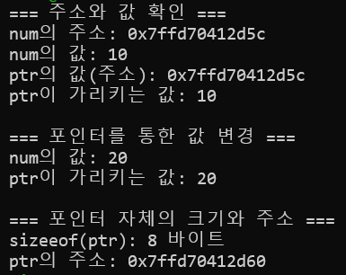
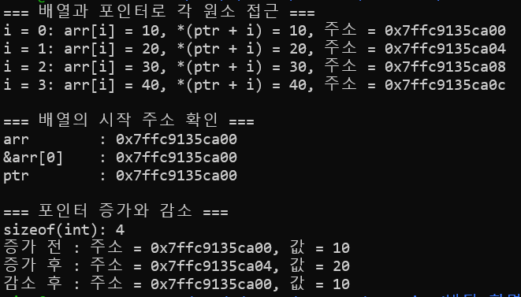
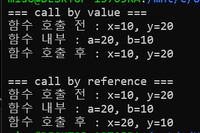

# Week 6

## 실행 환경
- 환경: Windows WSL (Ubuntu Linux)
- 컴파일러: GCC
- 디버거: GDB

## Challenge 1. 포인터 실습 기초

### 실습 코드
'''bash
#include <stdio.h>

int main(){
    int num = 10;
    int *ptr = &num;

    printf("=== 주소와 값 확인 ===\n");
    printf("num의 주소: %p\n", (void*)&num);
    printf("num의 값: %d\n", num);
    printf("ptr의 값(주소): %p\n",(void*)ptr);
    printf("ptr이 가리키는 값: %d\n", *ptr);

    printf("\n=== 포인터를 통한 값 변경 ===\n");
    *ptr = 20;
    printf("num의 값: %d\n", num);
    printf("ptr이 가리키는 값: %d\n", *ptr);

    printf("\n=== 포인터 자체의 크기와 주소 ===\n");
    printf("sizeeof(ptr): %zu 바이트\n", sizeof(ptr));
    printf("ptr의 주소: %p\n", (void*)&ptr);

    return 0;

}
'''
### 실행 결과

### 변수 크기 추론
포인터 변수의 크기는 8바이트로 확인되었다. 일반적인 64비트 Linux 프로그램에서는 메모리 주소를 저장하는 포인터를 64비트로 표현하므로 8바이트를 차지한다. 포인터의 크기는 가리키는 int 값의 크기가 아니라 실행 환경과 컴파일 방식에 따라 결정된다.

## Challenge 2. 포인터 연산 실습

### 실습 코드
'''bash
#include <stdio.h>

int main(void){
    int arr[4] = {10, 20, 30, 40};
    int *ptr = arr;

    printf("=== 배열과 포인터로 각 원소 접근 ===\n");

    for(int i  = 0; i<4; i++){
        printf("i = %d: arr[i] = %d, *(ptr + i) = %d, 주소 = %p\n",
             i, arr[i], *(ptr + i), (void*)(ptr +i));
    }

    printf("\n=== 배열의 시작 주소 확인 ===\n");
    printf("arr        : %p\n", (void*)arr);
    printf("&arr[0]    : %p\n", (void*)&arr[0]);
    printf("ptr        : %p\n", (void*)ptr);
    
    printf("\n=== 포인터 증가와 감소 ===\n");
    printf("sizeof(int): %zu\n", sizeof(int));
    printf("증가 전 : 주소 = %p, 값 = %d\n", (void*)ptr, *ptr);
    ptr++;
    printf("증가 후 : 주소 = %p, 값 = %d\n", (void*)ptr, *ptr);
    ptr--;
    printf("감소 후 : 주소 = %p, 값 = %d\n", (void*)ptr, *ptr);

    return 0;
}
'''

### 실행 결과

### 포인터 증가·감소에 따른 주소 변화

실행 결과 `sizeof(int)`는 4바이트였으며, 포인터의 주소 변화는 다음과 같았다.

| 상태 | 포인터에 저장된 주소 | 가리키는 값 |
|---|---|---|
| 증가 전 | `0x7ffc9135ca00` | 10 |
| `ptr++` 후 | `0x7ffc9135ca04` | 20 |
| `ptr--` 후 | `0x7ffc9135ca00` | 10 |

`ptr++`를 실행하면 주소가 4바이트 증가하여 다음 원소를 가리키고, `ptr--`를 실행하면 주소가 4바이트 감소하여 이전 원소를 가리킨다.

포인터 연산의 이동 단위는 **가리키는 자료형의 크기**이다. 따라서 `int *`인 ptr은 한 번 증가하거나 감소할 때 `sizeof(int)`인 4바이트만큼 이동한다.

### 배열 이름과 포인터의 관계

`arr`, `&arr[0]`, `ptr`을 출력한 결과 모두 `0x7ffc9135ca00`으로 같았다.

배열 이름 arr는 대부분의 식에서 첫 번째 원소를 가리키는 포인터로 변환된다. 따라서 `int *ptr = arr;`로 초기화하면 ptr에도 배열의 첫 번째 원소 주소가 저장된다.

ptr이 배열의 시작을 가리킬 때, `arr[i]`와 `*(ptr+i)`는 같은 원소에 접근한다.

| i | arr[i] | *(ptr+i) |
|---|---|---|
| 0 | 10 | 10 |
| 1 | 20 | 20 |
| 2 | 30 | 30 |
| 3 | 40 | 40 |

`arr[i]`는 `*(arr+i)`와 같은 의미이며, ptr에 arr의 시작 주소가 저장되어 있으므로 두 방식의 결과가 동일하다.

다만 **배열과 포인터 자체가 같은 것은 아니다.** ptr은 주소를 저장하는 변수이므로 `ptr++`로 가리키는 위치를 변경할 수 있지만, 배열 이름에는 `arr++`를 사용할 수 없다.

## Challenge 3. call by value vs call by reference 비

### 실습 코드
'''bash
#include <stdio.h>

void swap_by_value(int a, int b){
    int temp = a;
    a = b;
    b = temp;

    printf("함수 내부 : a=%d, b=%d\n", a,b);
}

void swap_by_reference(int *a, int *b){
    int temp = *a;
    *a = *b;
    *b = temp;

    printf("함수 내부 : a=%d, b=%d\n", *a, *b);
}

int main(void){
    int x = 10;
    int y = 20;

    printf("=== call by value ===\n");
    printf("함수 호출 전 : x=%d, y=%d\n", x, y);
    swap_by_value(x, y);
    printf("함수 호출 후 : x=%d, y=%d\n", x, y);

    printf("\n=== call by reference ===\n");
    printf("함수 호출 전 : x=%d, y=%d\n", x, y);
    swap_by_reference(&x, &y);
    printf("함수 호출 후 : x=%d, y=%d\n", x, y);
    return 0;
}
'''

### 실행 결과

### 두 방식의 차이와 사용 상황

| 구분 | call by value | call by reference |
|---|---|---|
| 전달하는 것 | 변수의 값 복사본 | 변수의 주소 복사본 |
| 함수 내부에서 변경 | 매개변수를 변경해도 원본은 유지됨 | 역참조(`*`)로 원본 값을 변경할 수 있음 |
| 사용 상황 | 원본을 유지하며 계산할 때 | 함수에서 호출자의 변수를 수정할 때 |
| 호출 예시 | `func(x)` | `func(&x)` |

> **주의:** C는 엄밀히 말해 모두 call by value 이다. 포인터 전달도 **주소값을 복사해서 전달**하지만, 복사된 주소로 원본 변수에 접근할 수 있어 call by reference 같은 효과를 낸다.
