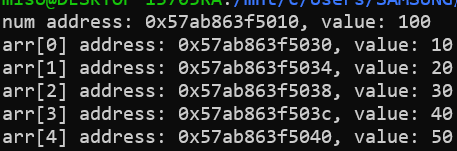
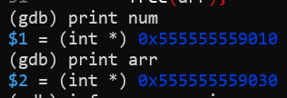
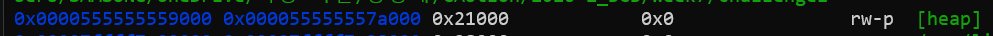
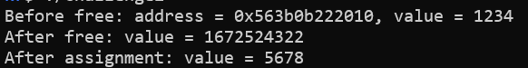
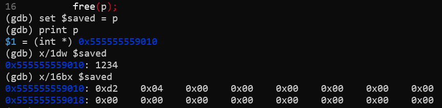
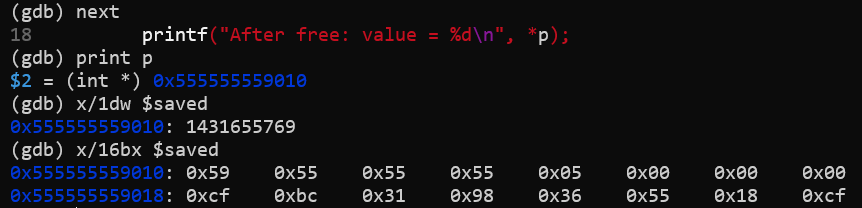
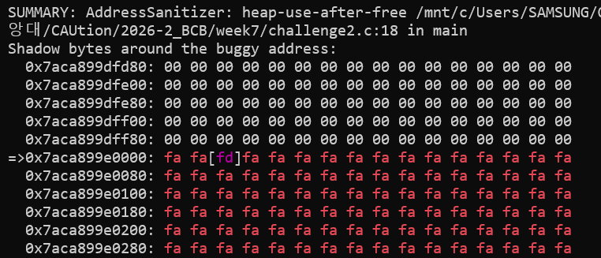

# Week 7

## 실행 환경

- 환경: Windows WSL (Ubuntu Linux)
- 컴파일러: GCC
- 디버거: GDB
- 메모리 오류 탐지 도구: AddressSanitizer

## Challenge 1. malloc / free 기초 실습

### 실습 목적

- `malloc()`으로 정수 1개와 정수 배열을 동적으로 할당한다.
- 할당된 메모리에 값을 저장하고 값과 주소를 출력한다.
- GDB로 할당된 주소가 Heap 영역에 포함되는지 확인한다.
- `malloc()` 실패 처리와 `free()`의 필요성을 이해한다.

### 실습 코드

```c
#include <stdio.h>
#include <stdlib.h>

int main(void){
    int *num = malloc(sizeof *num);

    if (num == NULL){
        fprintf(stderr, "Memory allocation failed\n");
        return 1;
    }
    
    int *arr = malloc(5*sizeof *arr);
    if (arr == NULL){
        fprintf(stderr, "Memory allocation failed\n");
        free(num);
        return 1;
    }
    
    *num = 100;

    for(int i = 0; i<5; i++){
        arr[i] = (i + 1) * 10;
    }

    printf("num address: %p, value: %d\n", (void*)num, *num);

    for(int i = 0; i < 5; i++){
        printf("arr[%d] address: %p, value: %d\n", i, (void*)&arr[i], arr[i]);
    }

    free(arr);
    free(num);

    num = NULL;
    arr = NULL;
    
    return 0;
}
```

### 실행 결과



| 대상 | 할당된 주소 | 저장된 값 |
|---|---|---|
| `num`이 가리키는 정수 | `0x57ab863f5010` | 100 |
| `arr[0]` | `0x57ab863f5030` | 10 |
| `arr[1]` | `0x57ab863f5034` | 20 |
| `arr[2]` | `0x57ab863f5038` | 30 |
| `arr[3]` | `0x57ab863f503c` | 40 |
| `arr[4]` | `0x57ab863f5040` | 50 |


### Heap 영역 확인

GDB에서 메모리를 해제하기 전에 다음 명령어로 포인터의 값과 메모리 영역을 확인하였다.

```gdb
print num
print arr
info proc mappings
```





| 확인 항목 | 관찰 결과 |
|---|---|
| `num`에 저장된 주소 | `0x555555559010` |
| `arr`에 저장된 주소 | `0x555555559030` |
| `[heap]` 시작 주소 | `0x555555559000` |
| `[heap]` 끝 주소 | `0x55555557a000` |

두 할당 주소 모두 `[heap]`의 시작 주소 이상, 끝 주소 미만에 포함되므로 이번 실습에서 할당된 메모리가 Heap 영역에 있음을 확인하였다.

### malloc() 실패 처리

`malloc()`은 메모리 할당에 실패하면 `NULL`을 반환한다. 따라서 반환값을 확인한 후 메모리에 접근해야 한다.

```c
if (num == NULL) {
    fprintf(stderr, "Memory allocation failed\n");
    return 1;
}
```

실패 여부를 확인하지 않고 `*num`과 같이 접근하면 정의되지 않은 동작이 발생한다.

또한 `num`의 할당은 성공했지만 `arr`의 할당이 실패한 경우에는 이미 할당한 `num`의 메모리를 해제하고 종료하도록 작성하였다.

### free()와 Memory Leak

`free()`는 동적으로 할당한 메모리를 더 이상 사용하지 않을 때 해제하는 함수이다.

필요 없어진 메모리를 해제하지 않으면 해당 공간이 계속 점유되어 **Memory Leak(메모리 누수)**이 발생할 수 있다. 특히 포인터를 덮어써서 할당된 주소를 잃어버리면 해당 메모리를 해제할 수 없게 된다.

메모리 누수가 반복되면 프로그램의 메모리 사용량이 증가하고, 성능 저하나 메모리 부족으로 이어질 수 있다.

일반적인 운영체제는 프로세스 종료 시 메모리를 회수하지만, 오래 실행되는 프로그램에서는 누수가 누적될 수 있으므로 사용이 끝난 메모리는 해제해야 한다.

## Challenge 2. Dangling Pointer 실험

### 실습 목적

- `free()` 이후 포인터와 메모리의 상태를 확인한다.
- 해제된 메모리에 다시 접근했을 때의 실행 결과를 관찰한다.
- GDB로 해제 전후 메모리 내용을 비교한다.
- Dangling Pointer와 Use After Free의 위험성을 이해한다.

### 실습 코드

아래 코드는 해제된 메모리에 접근하는 오류를 의도적으로 포함한 실험용 코드이다.

```c
#include <stdio.h>
#include <stdlib.h>

int main(void){
    int *p = malloc(sizeof *p);

    if (p == NULL){
        fprintf(stderr, "Memory allocation failed\n");
        return 1;
    }

    *p = 1234;

    printf("Before free: address = %p, value = %d\n", (void*)p, *p);

    free(p);

    printf("After free: value = %d\n", *p);
    
    *p = 5678;
    printf("After assignment: value = %d\n", *p);

    p = NULL;
    
    return 0;
}
```

### 실행 결과



| 확인 항목 | 실제 관찰 결과 |
|---|---|
| 할당된 주소 | `0x563b0b222010` |
| `free()` 전 값 | `1234` |
| `free()` 후 읽은 값 | `1672524322` |
| 해제 후 `5678`을 대입하고 읽은 값 | `5678` |
| 실행 상태 | 캡처된 실행에서는 크래시 없이 마지막 출력까지 진행됨 |

`free()` 이전에는 저장한 값인 `1234`가 출력되었지만, 해제 후에는 `1672524322`라는 예상하지 못한 값이 출력되었다.

이후 같은 포인터로 `5678`을 저장하고 읽었을 때는 `5678`이 출력되었다. 하지만 이는 정상적인 메모리 사용을 의미하지 않는다.

### GDB로 free() 전후 메모리 비교

`free(p)`를 실행하기 직전에 중단하고 다음 명령어를 입력하였다.

```gdb
set $saved = p
print p
x/1dw $saved
x/16bx $saved
```

| 명령어 | 의미 |
|---|---|
| `set $saved = p` | 관찰할 주소를 GDB 내부 변수에 저장 |
| `print p` | 포인터에 저장된 주소 확인 |
| `x/1dw $saved` | 해당 주소의 4바이트를 부호 있는 10진수로 확인 |
| `x/16bx $saved` | 해당 주소부터 16바이트를 바이트 단위 16진수로 확인 |

`x/16bx`는 할당한 정수의 4바이트뿐 아니라 주변 메모리도 함께 관찰하는 명령어이다.

**1. free() 실행 전**



- 포인터에 저장된 주소: `0x555555559010`
- 해당 주소에서 읽은 정수: `1234`
- 첫 4바이트: `0xd2 0x04 0x00 0x00`

이 환경은 낮은 주소에 하위 바이트를 저장하는 Little Endian 방식이므로, 위 4바이트는 `0x000004d2`, 즉 10진수 `1234`를 나타낸다.

**2. free() 실행 후**

`next`로 `free(p)`를 실행한 뒤 같은 주소를 다시 확인하였다.

```gdb
next
print p
x/1dw $saved
x/16bx $saved
```



| 확인 항목 | `free()` 전 | `free()` 후 |
|---|---|---|
| 포인터 `p`에 저장된 주소 | `0x555555559010` | `0x555555559010` |
| 해당 주소에서 읽은 정수 | `1234` | `1431655769` |
| 해당 주소의 첫 4바이트 | `d2 04 00 00` | `59 55 55 55` |

`free()` 이후에도 포인터에는 이전 주소가 남아 있었지만, 해당 주소의 메모리 내용은 변경되었다.


### AddressSanitizer를 이용한 오류 확인

다음 명령어로 메모리 오류 탐지 기능을 활성화하여 실행하였다.

```bash
gcc -g -O0 -fsanitize=address -fno-omit-frame-pointer challenge2.c -o challenge2_asan
./challenge2_asan
```



실행 결과 다음 오류가 탐지되었다.

```text
AddressSanitizer: heap-use-after-free
challenge2.c:18 in main
```

이는 Heap에서 할당받았다가 해제한 메모리에 다시 접근했음을 의미한다. 실습 파일에서는 18번째 줄의 `printf()`에서 `*p`를 읽는 부분이 오류로 탐지되었다.

출력된 메모리 상태 표시에서 `fd`는 해제된 Heap 영역을 의미한다.

일반 실행에서는 마지막 출력까지 진행되었지만, AddressSanitizer를 사용하면 해제된 메모리에 접근하는 오류를 확인할 수 있었다.

### Dangling Pointer와 Use After Free

| 개념 | 의미 |
|---|---|
| Dangling Pointer | 메모리가 해제되는 등으로 더 이상 유효하지 않은 대상을 가리키는 포인터 |
| Use After Free(UAF) | 해제된 메모리에 다시 접근하여 값을 읽거나 쓰는 동작 |

이번 실습에서는 `free(p)` 이후에도 `p`에 해제된 공간의 주소가 남아 Dangling Pointer가 되었다. 이후 `*p`로 값을 읽고 쓰는 과정에서 UAF가 발생하였다.

해제된 공간은 이후 다른 데이터 저장에 재사용될 수 있다. 이때 이전 포인터로 접근하면 다른 데이터를 잘못 읽거나 덮어쓸 수 있어 프로그램 오류, 데이터 손상, 정보 유출 등의 보안 문제로 이어질 수 있다.

### 예방 방법

사용이 끝난 메모리를 해제한 뒤에는 해당 포인터를 `NULL`로 설정하고 다시 역참조하지 않아야 한다.

```c
free(p);
p = NULL;
```
