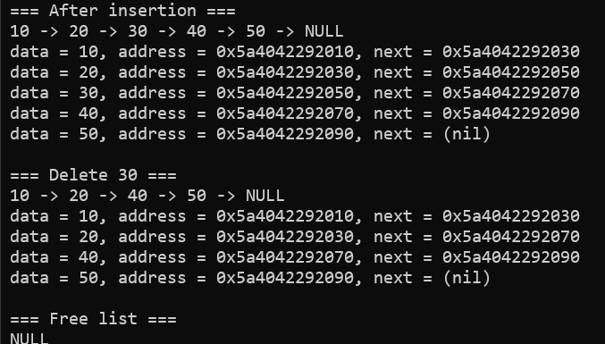
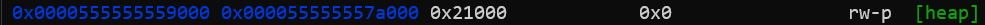
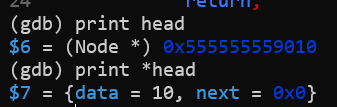
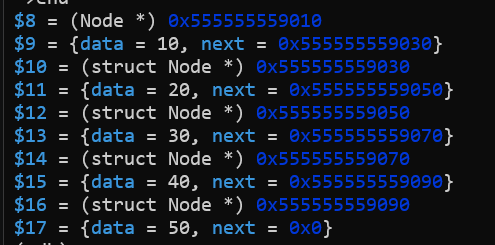
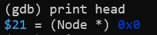
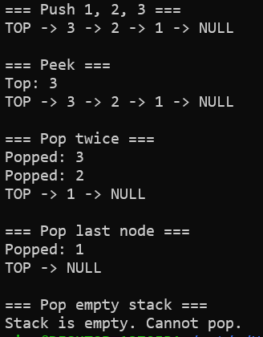

# Week 8

## 실행 환경

- 환경: Windows WSL (Ubuntu Linux)
- 컴파일러: GCC
- 디버거: GDB

## Challenge 1. 단순 연결리스트 구현

### 실습 코드

```c
#include <stdio.h>
#include <stdlib.h>

typedef struct Node{
    int data;
    struct Node *next;
} Node;

Node *head = NULL;

void insert(int data){
    Node *new_node = malloc(sizeof *new_node);

    if(new_node == NULL){
        fprintf(stderr, "Memory allocation failed\n");
        return;
    }

    new_node->data = data;
    new_node->next = NULL;

    if(head == NULL){
        head = new_node;
        return;
    }
    
    Node *current = head;
    while(current->next != NULL){
        current = current->next;
    }
    current->next = new_node;


}
void delete(int data){
    Node *current = head;
    Node *previous = NULL;

    while (current != NULL && current->data != data) {
        previous = current;
        current = current->next;
    }

    if (current == NULL) {
        printf("Value %d not found\n", data);
        return;
    }

    if (previous == NULL) {
        head = current->next;
    } else {
        previous->next = current->next;
    }

    free(current);
}

void print(void){
    Node *current = head;
    while(current != NULL){
        printf("%d -> ", current->data);
        current = current->next;
    }
    printf("NULL\n");
}

void print_address(void){
    Node *current = head;
    while(current != NULL){
        printf("data = %d, address = %p, next = %p\n", current->data, (void*)current, (void*)current->next);
        current = current->next;
    }
}

void free_list(void){
    while(head != NULL){
        Node *temp = head;
        head = head->next;
        free(temp);
    }
}

int main(void){
    for(int i = 1; i<=5; i++){
        insert(i*10);
    }

    puts("=== After insertion ===");
    print();
    print_address();

    puts("\n=== Delete 30 ===");
    delete(30);
    print();
    print_address();

    puts("\n=== Free list ===");
    free_list();
    print();
    
    return 0;
}
```

### 컴파일 및 실행

```bash
gcc -Wall -Wextra -g -O0 challenge1.c -o challenge1
./challenge1
```

### 실행 결과



| 실행 단계 | 결과 |
|---|---|
| 노드 5개 추가 | `10 -> 20 -> 30 -> 40 -> 50 -> NULL` |
| 중간 노드 30 삭제 | `10 -> 20 -> 40 -> 50 -> NULL` |
| 전체 노드 해제 | `NULL` |

30을 삭제한 뒤 20 노드의 `next`가 40 노드를 가리키도록 변경되었다. 프로그램 종료 전 `free_list()`로 남은 노드를 모두 해제하였다.

### GDB로 Heap 영역 확인

```gdb
print new_node
info proc mappings
```




| 확인 항목 | 관찰 결과 |
|---|---|
| 새 노드 주소 | `0x555555559010` |
| Heap 시작 주소 | `0x555555559000` |
| Heap 끝 주소 | `0x55555557a000` |

새 노드의 주소가 Heap 범위에 포함되어 동적으로 할당된 것을 확인하였다.

### 첫 번째 노드 확인

```gdb
print head
print *head
```



`head`는 `0x555555559010`을 가리켰으며, 첫 노드의 값은 `10`, `next`는 `NULL`이었다.

### 전체 연결 구조 확인



| 데이터 | 노드 주소 | next |
|---|---|---|
| 10 | `0x555555559010` | `0x555555559030` |
| 20 | `0x555555559030` | `0x555555559050` |
| 30 | `0x555555559050` | `0x555555559070` |
| 40 | `0x555555559070` | `0x555555559090` |
| 50 | `0x555555559090` | `NULL` |

각 노드의 `next`가 다음 노드의 주소와 일치하였으며, 마지막 노드의 `next`는 `NULL`이었다.

### 전체 해제 후 확인

```gdb
print head
```


`free_list()` 실행 후 `head`가 `0x0`, 즉 `NULL`인 것을 확인하였다.

## Challenge 2. 연결리스트 기반 스택 구현

### 실습 코드

```c
#include <stdio.h>
#include <stdlib.h>

typedef struct Node {
    int data;
    struct Node *next;
} Node;

Node *top = NULL;

void push(int data){
    Node *new_node = malloc(sizeof *new_node);

    if (new_node == NULL) {
        fprintf(stderr, "Memory allocation failed\n");
        return;
    }

    new_node->data = data;
    new_node->next = top;
    top = new_node;
}

int pop(void){
    if (top == NULL) {
        puts("Stack is empty. Cannot pop.");
        return 0;
    }

    Node *temp = top;
    int data = temp->data;

    top = temp->next;
    free(temp);

    printf("Popped: %d\n", data);
    return data;
}

int peek(void){
    if (top == NULL) {
        puts("Stack is empty. Cannot peek.");
        return 0;
    }

    printf("Top: %d\n", top->data);
    return top->data;
}

void print_stack(void){
    Node *current = top;

    printf("TOP -> ");

    while (current != NULL) {
        printf("%d -> ", current->data);
        current = current->next;
    }

    puts("NULL");
}

void free_stack(void){
    while (top != NULL) {
        Node *temp = top;
        top = temp->next;
        free(temp);
    }
}

int main(void){
    puts("=== Push 1, 2, 3 ===");
    push(1);
    push(2);
    push(3);
    print_stack();

    puts("\n=== Peek ===");
    peek();
    print_stack();

    puts("\n=== Pop twice ===");
    pop();
    pop();
    print_stack();

    puts("\n=== Pop last node ===");
    pop();
    print_stack();

    puts("\n=== Pop empty stack ===");
    pop();

    free_stack();

    return 0;
}
```

### 컴파일 및 실행

```bash
gcc -Wall -Wextra -g -O0 challenge2.c -o challenge2
./challenge2
```

### 실행 결과



